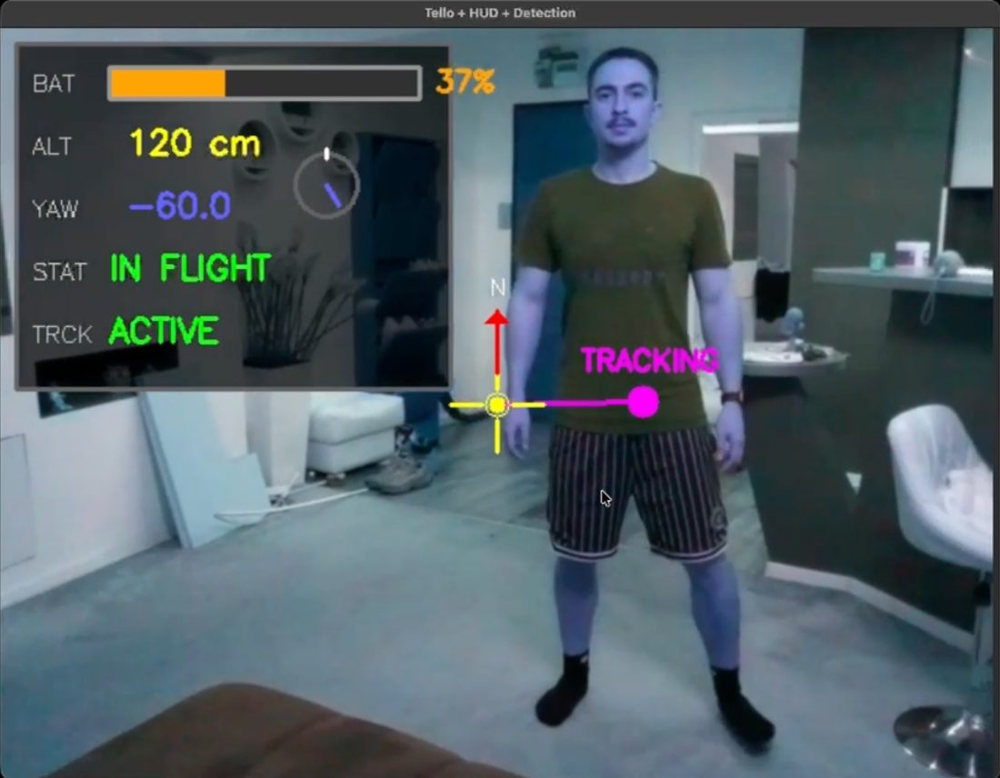
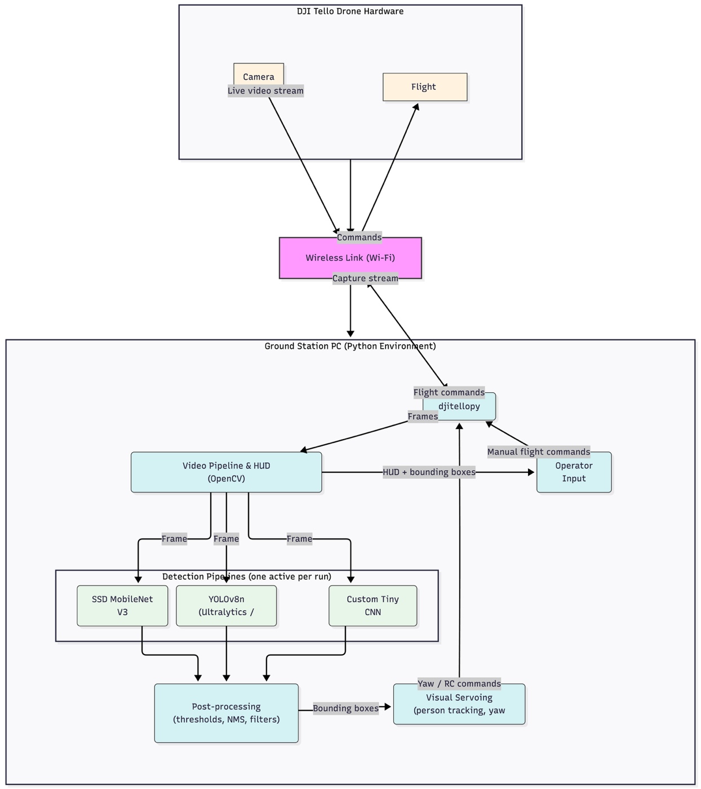
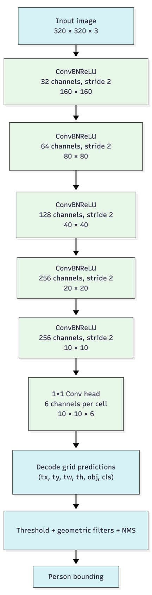

# Object Detection Drone Using AI

Real-time person detection and autonomous tracking on a **DJI Tello** drone, with three detectors benchmarked side by side: **SSD MobileNet V3**, **YOLOv8n** and **TinyCNN**, a custom detector designed and trained from scratch in PyTorch.

Bachelor's thesis, Technical University of Cluj-Napoca, Faculty of Automation and Computer Science (2026). Author: Stefan-Horus Corcan. Supervisor: Conf. Dr. Ing. Dan Gota.



## Highlights

- **Live detection on the drone's Wi-Fi video stream**, with bounding boxes and confidence scores drawn in real time.
- **Autonomous person tracking**: proportional visual servoing on the yaw axis, with a dead zone to avoid oscillation and instant manual override.
- **Custom TinyCNN detector**: a YOLO-style, single-class network (5 Conv-BN-ReLU blocks, 320×320 input, 10×10 grid) trained on a person subset of COCO 2017.
- **Fair benchmark**: all three models evaluated on the same 2,693-image, 11,004-person test set with precision, recall and F1 at IoU 0.5.
- **Flight HUD** showing battery, altitude, yaw, flight status and tracking status, plus keyboard flight control.
- **Safe shutdown**: zero velocities, automatic landing if airborne, stream stop and resource release.

## Results

| Model | Precision | Recall | F1 | Live FPS |
| --- | --- | --- | --- | --- |
| YOLOv8n (pretrained) | 0.885 | 0.563 | **0.688** | ~35–40 |
| TinyCNN (this project) | **0.920** | 0.392 | 0.550 | **~60–70** |
| SSD MobileNet V3 (pretrained) | 0.746 | 0.448 | 0.560 | ~25–30 |

COCO 2017 person subset, IoU threshold 0.5. TinyCNN is the most precise and roughly twice as fast as the baselines, at the cost of lower recall; YOLOv8n gives the best overall F1.

## Architecture

<p align="center">
  
  &nbsp;&nbsp;
  
</p>

The ground station receives frames from the Tello over Wi-Fi, runs one detector per session, post-processes the detections (confidence threshold, geometric filters, NMS), draws the HUD and sends RC commands back to the drone, from the keyboard or from the tracking controller.

## Project structure

| File | Purpose |
| --- | --- |
| `main.py` | Flight app with SSD MobileNet V3 (OpenCV DNN), full HUD and tracking |
| `yolo_main.py` | Flight app with YOLOv8n (Ultralytics) |
| `custom_cnn_main.py` | Flight app with the custom TinyCNN detector |
| `tiny_cnn_detector.py` | TinyCNN model, prediction decoding, NMS and inference helpers |
| `train_tiny_cnn.py` | Training script for TinyCNN on YOLO-format labels |
| `prepare_coco_person.py` | Builds a person-only YOLO-format dataset from COCO 2017 |
| `evaluate_models.py` | Precision / recall / F1 benchmark of all three models |
| `tiny_cnn_person.pt` | Trained TinyCNN weights |
| `yolov8n.pt` | YOLOv8n weights (kept locally: the Tello Wi-Fi has no internet) |
| `frozen_inference_graph.pb`, `ssd_mobilenet_v3_large_coco_2020_01_14.pbtxt`, `coco.names` | SSD MobileNet V3 model, config and class names |

## Setup

Tested with Python 3.9 on macOS.

```bash
git clone https://github.com/stefanhorus/Drone-Object-Detection-.git
cd Drone-Object-Detection-
python3 -m venv .venv && source .venv/bin/activate
pip install -r requirements.txt
```

## Fly the drone

1. Turn on the Tello and connect your computer to its Wi-Fi network.
2. Run one of the flight apps:

```bash
python3 main.py              # SSD MobileNet V3
python3 yolo_main.py         # YOLOv8n
python3 custom_cnn_main.py   # TinyCNN
```

| Key | Action |
| --- | --- |
| `Space` / `L` | Take off / land |
| Arrow keys | Move left, right, forward, back |
| `W` / `S` | Up / down |
| `A` / `D` | Rotate left / right (overrides tracking) |
| `T` | Toggle person tracking |
| `F` / `B` / `E` / `R` | Flip forward / back / left / right |
| `Q` | Quit (lands safely if airborne) |

Fly in an open space and keep the drone in sight; tracking only controls yaw, so you stay in charge of distance and altitude.

## Train and evaluate

The dataset is not included. Download the COCO 2017 annotations and images from [cocodataset.org](https://cocodataset.org/#download), then:

```bash
# 1. Build the person-only dataset (YOLO format)
python3 prepare_coco_person.py --coco-root coco --split train

# 2. Train TinyCNN
python3 train_tiny_cnn.py --images data/images/train --labels data/labels/train --epochs 40

# 3. Benchmark all three models
python3 evaluate_models.py --images data/images/val --labels data/labels/val
```

## Limitations and future work

- Tracking controls yaw only; full 3D following would need forward/backward and altitude control (e.g. PID).
- Kalman filtering would smooth detections between frames.
- Fine-tuning on footage recorded from the Tello itself would improve recall in real flight.
- Running inference on board an edge device (Jetson, Coral) would remove the Wi-Fi round trip.

## Acknowledgements

[djitellopy](https://github.com/damiafuentes/DJITelloPy), [Ultralytics YOLOv8](https://github.com/ultralytics/ultralytics), the [TensorFlow Object Detection model zoo](https://github.com/tensorflow/models/tree/master/research/object_detection) (SSD MobileNet V3) and the [COCO dataset](https://cocodataset.org).
